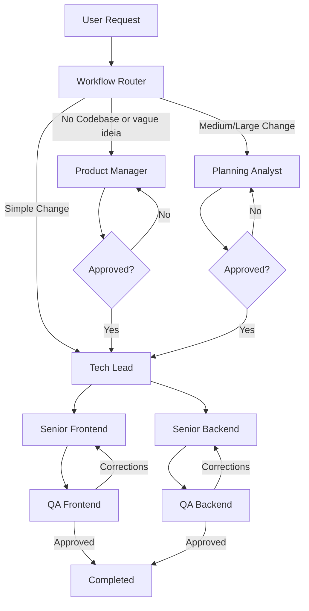

# Delivery Pipeline Skill

## Purpose

Orchestrate the complete software delivery workflow from an initial user request through planning, task creation, implementation, review, and completion.

This skill is the single entry point for project execution and is responsible for workflow orchestration, state persistence, recovery after interruptions, and information handoff between agents.

## Templates

All templates are stored in `.opencode\template` and template variables are inside `.opencode\template\variables.md` 

## Commands

### New Execution

```text
delivery-pipeline:new
```

Starts a new delivery workflow.

Responsibilities:

1. Generate a context name.
2. Create the planning folder structure if needed.
3. Create [PIPELINE_FILE] using [PIPELINE_TEMPLATE_FILE].
4. Invoke the Workflow Router skill.
5. Execute the selected workflow.
6. Persist progress after every agent execution.

### Resume Execution

```text
delivery-pipeline:resume
```

Resumes the last execution from [PIPELINE_FILE].

Responsibilities:

1. Load pipeline state.
2. Identify incomplete steps.
3. Resume execution from the last known state.
4. Avoid re-executing completed work.

## Pipeline State

Pipeline state is stored in:

```text
[PIPELINE_FILE]
```

The pipeline file is the source of truth for workflow execution.
It must be updated after every agent execution by the orchestrator.

## Responsibilities

### Workflow Orchestration

Responsible for:

* Invoking Workflow Router
* Invoking Product Manager
* Invoking Planning Analyst
* Invoking Tech Lead
* Invoking Senior Frontend agents
* Invoking Senior Backend agents
* Invoking QA Frontend
* Invoking QA Backend

### State Management

Responsible for:

* Creating pipeline state
* Updating pipeline state
* Tracking execution progress
* Tracking task completion
* Tracking errors
* Tracking concerns
* Maintaining execution history
* Supporting workflow recovery

### Orchestrator Must Never Do Agent Work

The orchestrator must **never** implement, write, or modify source code directly. Its sole responsibility is dispatching agents, managing state, and passing context.

If an agent:
- Returns an error → re-call the same agent with the error context
- Returns a partial result → re-call to complete the remaining work
- Returns non-standard format → re-call with format requirements
- Asks a question → respond to the agent directly (do not resolve it yourself)
- Times out → verify output dir; if files were created, mark done; otherwise re-call with higher timeout

**Never fix agent output yourself.** If an agent's code has a bug or build error, re-call the agent with the error details. Do not edit the agent's files, run build commands, or patch the code manually.

**Never run validation commands yourself.** Build, lint, and typecheck commands are the responsibility of subagents and QA. The orchestrator only dispatches agents and updates pipeline state.

If the orchestrator needs to make any code change, it must dispatch an agent to do it.

### Information Handoff

The orchestrator must provide agents with all available context whenever possible.

The orchestrator should pass the minimum set of information required for execution.

Agents should not need to locate, search, or aggregate project context on their own whenever the information is already available.

Agents should not need to read:

```text
epics/
tasks/
planning/
pipeline.yaml
```

unless their role explicitly requires it.

The orchestrator should consolidate and pass:

* User request
* Selected approach
* Approved planning artifacts
* Epic summaries
* Task summaries
* Acceptance criteria
* Relevant dependencies
* Previous execution results

## Workflow



### Step 1 - Route Request

Invoke:

```text
workflow-router
```

The router determines whether the request should be handled by:

* Product Manager
* Planning Analyst
* Tech Lead

### Product Manager Flow

When Product Manager is selected:

1. Execute Product Manager.
2. Wait for epic creation.
3. Update pipeline.
4. Execute Tech Lead.

### Planning Flow

When Planning Analyst is selected:

1. Execute Planning Analyst.
2. Present approaches to the user.
3. Wait for semantic approval.
4. Repeat planning loop until approved.
5. Generate planning documents.
6. Update pipeline.
7. Execute Tech Lead.

Planning documents must not be created before approval.

### Tech Lead Flow

Execute Tech Lead.

Expected outputs:

* Task files
* Task dependencies
* Ownership assignments
* Execution order

Update pipeline.

### Parallel Development Phase

Read task ownership and dependencies.

Tasks without unmet dependencies may execute immediately.

The orchestrator must maximize parallel execution whenever dependencies allow.

### Parallel Execution Phase

Dispatch **multiple** Senior Frontend/Backend agents simultaneously when independent tasks are available. Do not limit to one agent per role — if 3 frontend tasks are independent, create 3 Senior Frontend agents in parallel. Each agent receives exactly one task.

Pass:

* Assigned task (one per agent)
* Acceptance criteria
* Relevant context
* Dependency information
* Task file path for exact step-by-step code
* Standard response format requirement — instruct the agent to return using the [standard agent response format](references/agent-response-format.md)

Update pipeline after every completed task.

**Important: one agent per task** — never assign multiple tasks to a single agent if they can run in parallel.

### QA Phase

Execute:

* QA Frontend
* QA Backend

in parallel whenever possible.

Provide:

* Original task
* Acceptance criteria
* Relevant implementation context
* Git diff for files modified by the reviewed task

QA validates implementation against requirements.

Exactly one QA Frontend instance reviews frontend work.

Exactly one QA Backend instance reviews backend work.

### Corrections Loop

If QA returns:

```text
Corrections Needed
```

The orchestrator must:

1. Update pipeline.
2. Send feedback to the responsible implementation agent.
3. Re-execute implementation.
4. Re-execute QA.

Repeat until approved.

### Completion

Workflow completes when:

* All tasks are completed
* All QA reviews are approved
* No pending work remains

Update pipeline status to completed.

## Parallelization Rules

See [references/parallelization-rules.md](references/parallelization-rules.md)

## Failure Recovery

See [references/failure-recovery.md](references/failure-recovery.md)

## Pipeline Updates

After every agent execution update:

* status
* notes
* updated_at
* errors
* concerns

and append a history record.

Implementation task status must also be updated.

Examples:

[ ] TASK-01 Create User Endpoint
[X] TASK-02 Create User Screen

Errors and concerns examples:

```
errors:
  - "Build failed (TS error: info.event.revert() possibly undefined)"
  - "Subagent created files outside task scope (test helper script)"
concerns:
  - "Shell blocked npx tsc — subagent used pnpm build workdir instead"
  - "Subagent could not verify lint (no lint script configured)"
```

## Standard Agent Response Format

See [references/agent-response-format.md](references/agent-response-format.md)

## Task Tracking

See [references/task-tracking.md](references/task-tracking.md)

## Constraints

* Pipeline state is the source of truth.
* Always update pipeline state after agent execution.
* Never lose execution history.
* Never recreate completed work during resume.
* Always maximize safe parallelism.
* Always preserve task dependency order.
* Planning approval is mandatory before plan generation.
* QA must validate implementation against task requirements and git diff.
* Respect project boundaries and conventions.
* Never access files outside the project root.
* **Never do agent work** — the orchestrator must not write, edit, or implement source code. Only dispatch agents.
* **One task per agent dispatch** — never assign multiple tasks to a single agent instance. Create N agents for N independent tasks.
* **On error, re-call the agent** — never attempt to fix agent work manually. Re-dispatch with error context.
* **Record subagent concerns** — every error, concern, and deviation returned by a subagent must be recorded in the pipeline state under the appropriate step's `errors` or `concerns` array.
* **Enforce standard response format** — if a subagent does not follow the [standard agent response format](references/agent-response-format.md), re-call it with the format requirement. Do not parse ad-hoc responses.
* **Never run validation or build** — the orchestrator does not execute build, lint, typecheck, or test commands. That is the exclusive responsibility of subagents and QA.
* **Never create test/support files** — subagents must not create auxiliary files outside their task scope. Every file must be justified by a task requirement.
